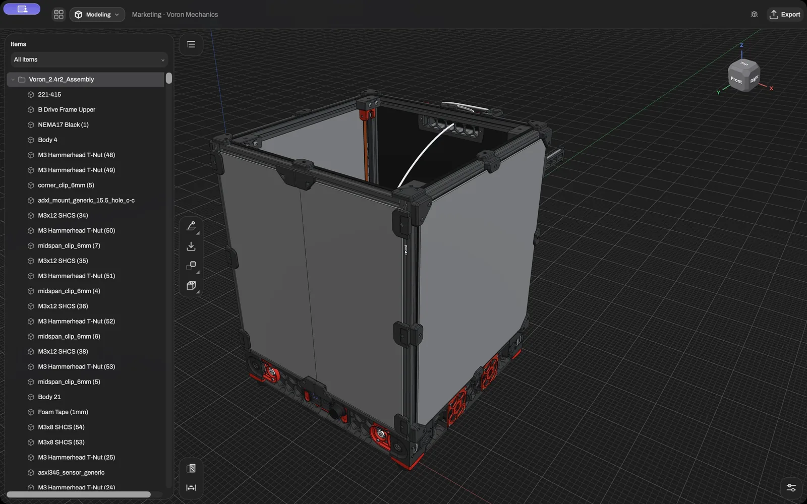
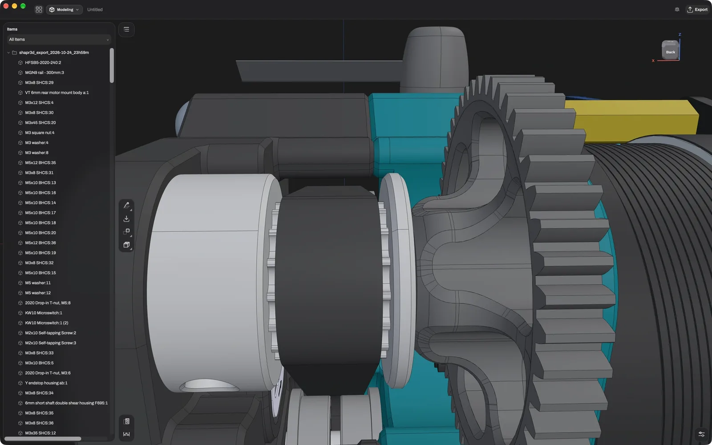
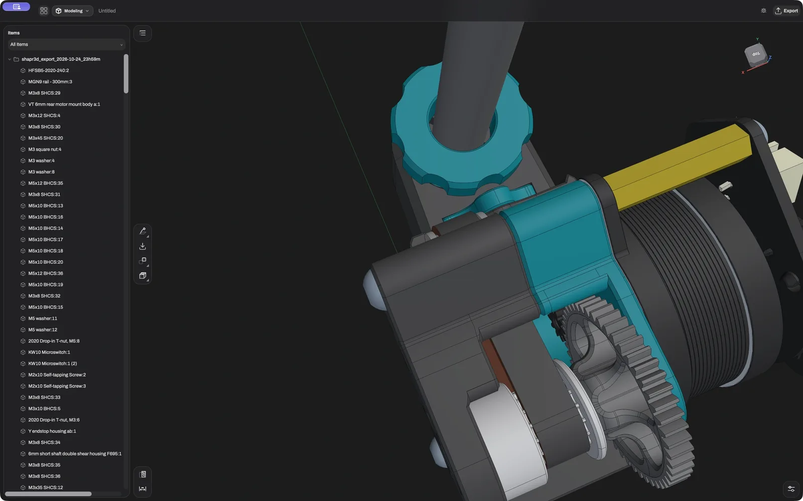

<p align="center">
  
</p>

<h1 align="center">Bezier</h1>

<p align="center">
  Parametric CAD that runs on your own machine.<br>
  In the browser, and as a desktop app for macOS, Linux and Windows.
</p>

<p align="center">
  <a href="https://bezier-cad.xyz">Website</a> ·
  <a href="https://bezier-cad.xyz/download/">Download</a> ·
  <a href="docs/README.md">Docs</a> ·
  <a href="CONTRIBUTING.md">Contributing</a>
</p>

<p align="center">
  <a href="https://github.com/ProfessorEngineergit/bezier/actions/workflows/ci.yml"></a>
  <a href="LICENSE"></a>
</p>

---

Hi, and welcome! Bezier is a CAD program for designing real parts: brackets, enclosures,
printer upgrades, whatever you are building. You sketch a shape, pull it into 3D, round off the
edges, and when you later change a dimension, everything after it follows along. Your model is a
history of steps, so going back and changing your mind is never a problem.

Bezier runs on your own computer. There is no account to create and nothing gets uploaded: your
projects stay with you, and the app keeps working without an internet connection.

Bezier is in **alpha**. It is already useful for real work, and it will still surprise you now
and then. If it does, I'd love to hear about it.

## What you can do with it

You can **model** with sketches, extrudes, revolves, lofts, sweeps, fillets, chamfers, shells,
holes and patterns, all kept in a history you can edit at any point. When the part is done, you
can turn it into a **technical drawing** with views, dimensions and a title block and save it as
PDF or DXF, or make it look good in **Visualize** with real materials and studio light, down to a
different material on every face. If you want to know whether it will hold, there is a
**simulation** of static stress.

Bezier opens and saves **STEP, IGES, STL, OBJ, 3MF, DXF and SVG**, and it handles big assemblies
too: every picture here is a complete Voron 2.4 3D printer.

New to CAD? There are **lessons inside the app** that you can follow step by step, and you can
record your own. Coming from another program? Pick its **keymap** and your hands already know
where everything is; every key can be changed.

<table>
  <tr>
    <td width="50%"></td>
    <td width="50%"></td>
  </tr>
  <tr>
    <td></td>
    <td></td>
  </tr>
</table>

## How well it runs on your system

To be honest with you up front: **macOS** runs really well. It is where Bezier is built and used
every day. **Linux** runs well too. **Windows** is the weakest of the three right now. I don't
have a Windows laptop, so most of the Windows testing happens in a virtual machine on my home
lab, which doesn't have much RAM to spare :)

Because of that, I built in a lot of extra checks on Windows. When something looks off, the app
would rather stop and tell you than carry on with a model it isn't sure about. So in the first
days you might run into a few more error messages on Windows than elsewhere. If that happens,
please [open an issue](https://github.com/ProfessorEngineergit/bezier/issues/new/choose). Every
report helps a lot, and it is how Windows will catch up.

There is more detail on what is tested where in [`docs/platforms.md`](docs/platforms.md).

## Helping out

Bezier is open source, and every contribution is welcome, big or small: a bug report, an idea, a
fix, a lesson, a plugin, or just a typo you spotted. You don't need to be a CAD expert or a
seasoned programmer to help.

If you use Windows, you can help more than most, simply by using Bezier and telling me what
breaks. And if you know your way around Windows internals or WebView2, I would be especially
happy to hear from you.

[`CONTRIBUTING.md`](CONTRIBUTING.md) walks you through getting started, and
[`docs/`](docs/README.md) explains how the pieces fit together. If you found a security problem,
please go through [`SECURITY.md`](SECURITY.md) instead of opening a public issue.

### Running it from source

You need Node 22 or newer and pnpm 9 or newer:

```bash
pnpm install
pnpm dev        # the app at http://localhost:5173
pnpm check      # lint, types and unit tests
pnpm e2e        # the app in a real browser
```

The desktop app also needs Rust; start it with `pnpm --filter @bezier/desktop dev`. On Linux a
few system packages are needed as well, listed in [`apps/desktop/README.md`](apps/desktop/README.md).

## How it is built

Bezier is written in TypeScript, as a pnpm monorepo. It stands on the shoulders of some great
open-source projects: the [Open CASCADE](https://dev.opencascade.org/) geometry kernel (compiled
to WebAssembly), the [planegcs](https://github.com/Salusoft89/planegcs) constraint solver and
[Three.js](https://threejs.org/) for drawing. The desktop app uses [Tauri](https://tauri.app/).
On top of those, Bezier adds the feature history, the interface and everything that ties them
together.

The trickiest part is keeping references stable. When you change an early step, a fillet you
added later still has to find its edge, even though the kernel renumbers everything on every
rebuild. [`packages/core`](packages/core/README.md) explains how that works, and
[`docs/architecture.md`](docs/architecture.md) gives you the whole picture.

## License

Bezier is free software under the [GNU General Public License v3 or later](LICENSE): you can use
it for anything, change it and share it. The servers (`apps/sync-server/` and the community
servers) are under the AGPL v3 or later, and the plugin SDK is MIT, so your plugins can use any
license you like. The name and logo are not part of the license; see
[`docs/legal/trademarks.md`](docs/legal/trademarks.md).

[`docs/legal/licensing.md`](docs/legal/licensing.md) explains all of this in plain language, and
[`docs/legal/third-party-licenses.md`](docs/legal/third-party-licenses.md) lists the projects
Bezier builds on. Thank you to all of them.
